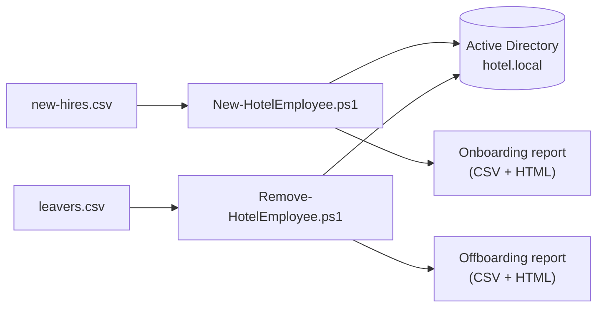
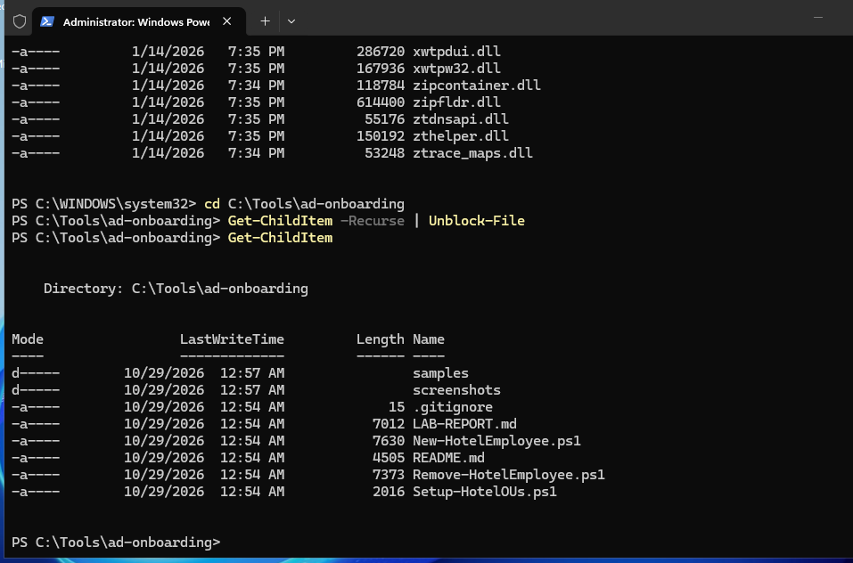
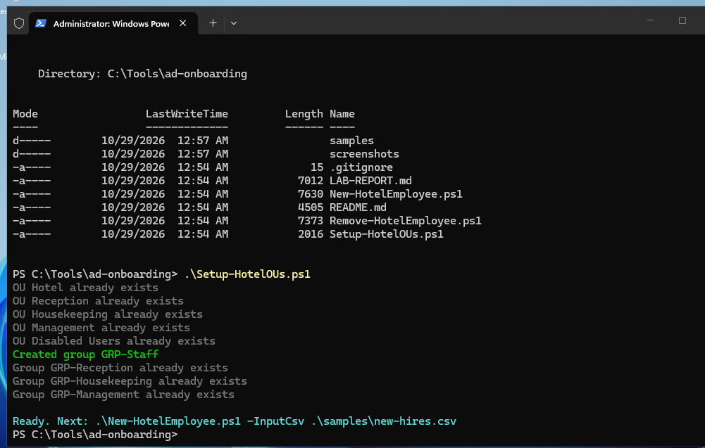
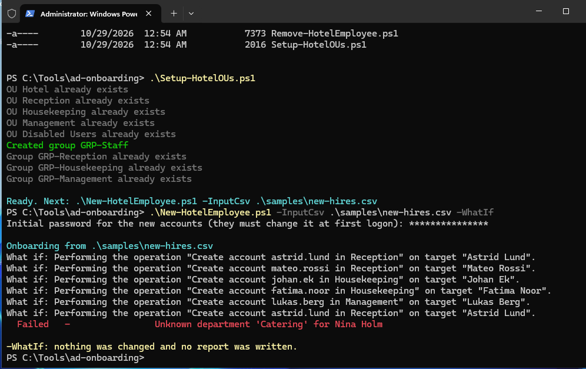
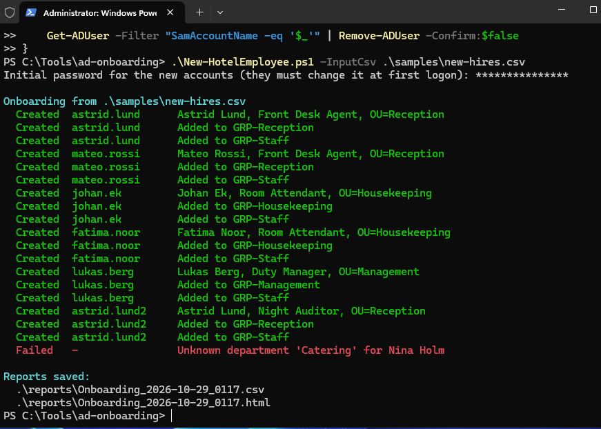
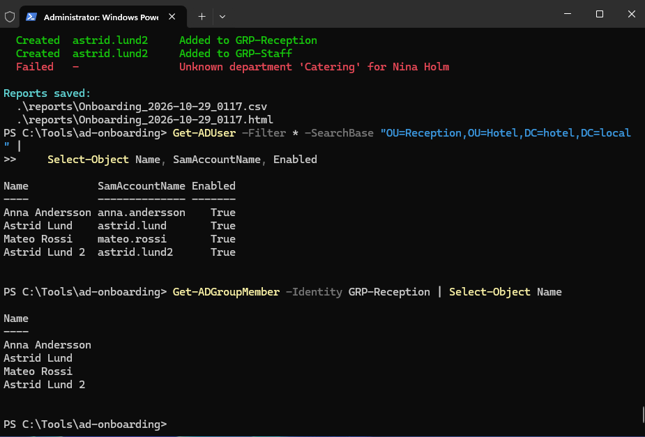
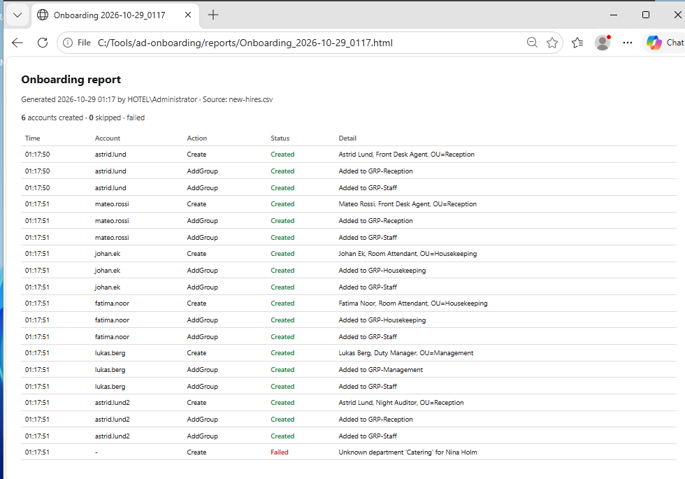
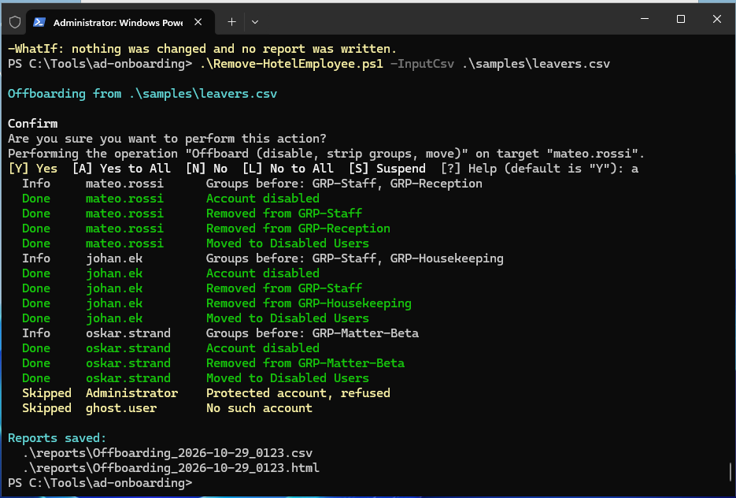
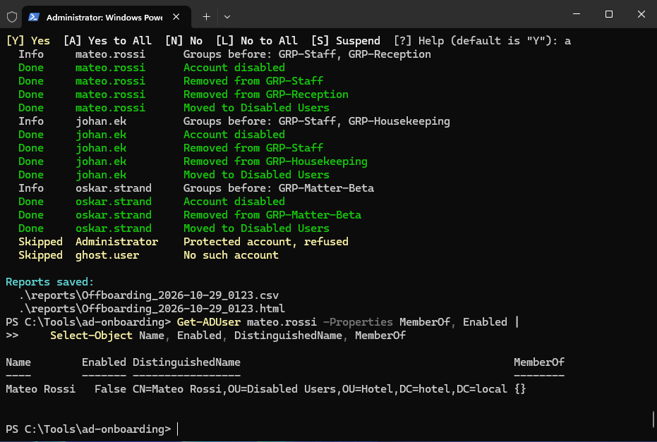

# Lab report: AD Onboarding & Offboarding Automation

**Environment:** Windows Server VM `HOTEL-DC01`, domain `hotel.local` (my home lab)
**Tools:** PowerShell, Active Directory module, Active Directory Users and Computers

## Summary

I built and tested two PowerShell scripts that automate the most common
first-line IT task in a Windows shop: creating accounts for new staff and
shutting them down cleanly when people leave. I ran them against a fictional
hotel, including the awkward cases (duplicate names, an unknown department, a
protected admin account, and a leaver who no longer exists), and I fixed a real
bug that only showed up against live Active Directory.

| Step | What I did | Result |
|---|---|---|
| Setup | Created the OUs and groups | OK |
| Onboard | Created 6 accounts from a CSV | 6 created, 1 rejected (bad department) |
| Verify | Checked the users and groups in AD | All correct |
| Offboard | Disabled 3 leavers from a CSV | 3 offboarded, admin refused, missing one skipped |
| Verify | Checked a leaver was disabled and moved | Confirmed |

## Why I built this

New hires and leavers are handled by IT support every week. By hand it's slow
and easy to get wrong: a typo in a username, the wrong group, or — the real
risk — a leaver whose account is never disabled and whose access lingers for
months. I wanted a project that turns both jobs into something repeatable and
leaves an audit trail, and that connects what I've learned about Active
Directory, permissions and PowerShell to a real workplace task.

This is a lab project with fictional users, not production experience.

## Lab design



Each department maps to its own OU (Reception, Housekeeping, Management) and
security groups. Everyone also goes into `GRP-Staff`. Leavers are moved to a
`Disabled Users` OU.

## Step 1 — Prepare the files

**Why:** scripts copied in from another machine are blocked by Windows until you
allow them. Allowing scripts for just this PowerShell window is safer than
changing the whole machine.

```powershell
cd C:\Tools\ad-onboarding
Set-ExecutionPolicy -Scope Process -ExecutionPolicy Bypass
Get-ChildItem -Recurse | Unblock-File
Get-ChildItem
```



## Step 2 — Create the OUs and groups

**Why:** the onboarding script places each user in their department's OU and
adds them to that department's groups, so those have to exist first. This script
creates them and is safe to rerun — here the OUs already existed from an earlier
lab, so it reused them and only created the missing `GRP-Staff` group.

```powershell
.\Setup-HotelOUs.ps1
```



## Step 3 — Preview the onboarding

**Why:** before creating anything in a directory, see what the script *would*
do. `-WhatIf` runs the whole thing but makes no changes and writes no report.
This is the habit that stops mistakes.

```powershell
.\New-HotelEmployee.ps1 -InputCsv .\samples\new-hires.csv -WhatIf
```



## Step 4 — Run the onboarding

**Why:** now create the accounts. The script asks for one initial password
(hidden) that all new users get, and each must change it at first logon.

```powershell
.\New-HotelEmployee.ps1 -InputCsv .\samples\new-hires.csv
```

Six accounts created. Two things worth pointing out:

- The two people named **Astrid Lund** became `astrid.lund` and `astrid.lund2` —
  the script never creates a duplicate.
- **Nina Holm** is in department *Catering*, which isn't mapped, so she's
  **rejected** rather than put somewhere wrong. Better to fail loudly than guess.



### Verify in Active Directory

**Why:** never trust a script's own output alone. Check the directory itself.

```powershell
Get-ADUser -Filter * -SearchBase "OU=Reception,OU=Hotel,DC=hotel,DC=local" |
    Select-Object Name, SamAccountName, Enabled
Get-ADGroupMember -Identity GRP-Reception | Select-Object Name
```

Both Astrids are present and enabled, with distinct names (`Astrid Lund` and
`Astrid Lund 2`) and distinct usernames.



### The report

**Why:** the HTML report is what you'd hand to a manager or keep for the record.
It lists every action and who ran it.



## Step 5 — Offboard the leavers

**Why:** when people leave, their access has to go the same day. This script
disables the account rather than deleting it, so mailbox data and audit history
survive, and it records what the person could reach before removing it.

```powershell
.\Remove-HotelEmployee.ps1 -InputCsv .\samples\leavers.csv -WhatIf   # preview
.\Remove-HotelEmployee.ps1 -InputCsv .\samples\leavers.csv           # real run
```

The real run asks for confirmation because it's destructive. It:

- recorded each leaver's groups **before** removing them,
- disabled the account, stripped the groups, and moved it to Disabled Users,
- **refused Administrator** (a protected account), and
- skipped `ghost.user`, which doesn't exist, without stopping the run.



### Verify

```powershell
Get-ADUser mateo.rossi -Properties MemberOf, Enabled |
    Select-Object Name, Enabled, DistinguishedName, MemberOf
```

`Enabled` is `False`, the account is under **Disabled Users**, and `MemberOf` is
empty (only Domain Users remains, which doesn't show here).



## Troubleshooting: a bug that only real AD could find

On the first real onboarding run, the second Astrid Lund failed:

```
Failed  astrid.lund2  An attempt was made to add an object to the directory
                      with a name that is already in use
```

**What was happening:** my script made the *username* unique (`astrid.lund2`)
but still tried to give the account the same **display name** ("Astrid Lund") in
the same Reception OU. Active Directory won't allow two objects with the same
name (CN) in one container, so it rejected the second one.

I'd tested the scripts beforehand against mocked AD cmdlets, and that test passed
— because my mock only checked usernames, not the display-name rule that real AD
enforces. This is exactly why testing in a real environment matters.

**The fix:** make both the username *and* the display name unique together, so
the second Astrid becomes `astrid.lund2` / "Astrid Lund 2". After the fix, the
run completed cleanly (the screenshots above are from the fixed run), and I added
the display-name case to the test so it can't regress.

**What I took from it:** a tool passing its own tests isn't proof it works. Real
systems enforce rules a simplified test won't, so I verify against the real thing
and treat the first failure as information, not a setback.

## What this shows

- Writing PowerShell that's safe against a live directory: `-WhatIf`,
  confirmation on destructive actions, skipping work already done, refusing
  protected accounts
- The full identity lifecycle: joiner and leaver
- Active Directory: users, OUs, security groups, moving objects
- Turning a manual, error-prone task into a repeatable one driven by a CSV
- Producing an audit trail a non-technical manager can read
- Finding and fixing a real bug, and hardening the test so it won't come back

## Limitations

- Lab/portfolio project, run in a lab domain with fictional users.
- The initial password is one shared value typed at the prompt. In production
  you'd generate a unique password per user and deliver it over a secure channel.
- Doesn't create mailboxes, home folders or licences — the natural next step
  (Exchange / Entra ID).

## Next steps

- Create the mailbox and assign a licence on onboarding (Exchange / Entra ID)
- Generate a unique random password per user and deliver it securely
- Run the offboarding as a scheduled task that reads an HR export
- Email the HTML report to the service desk automatically
